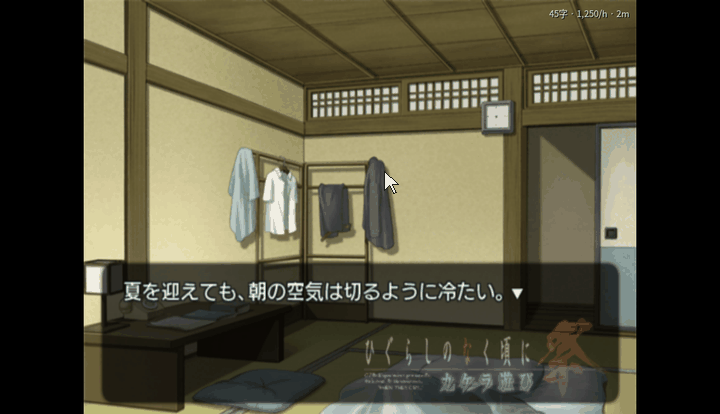
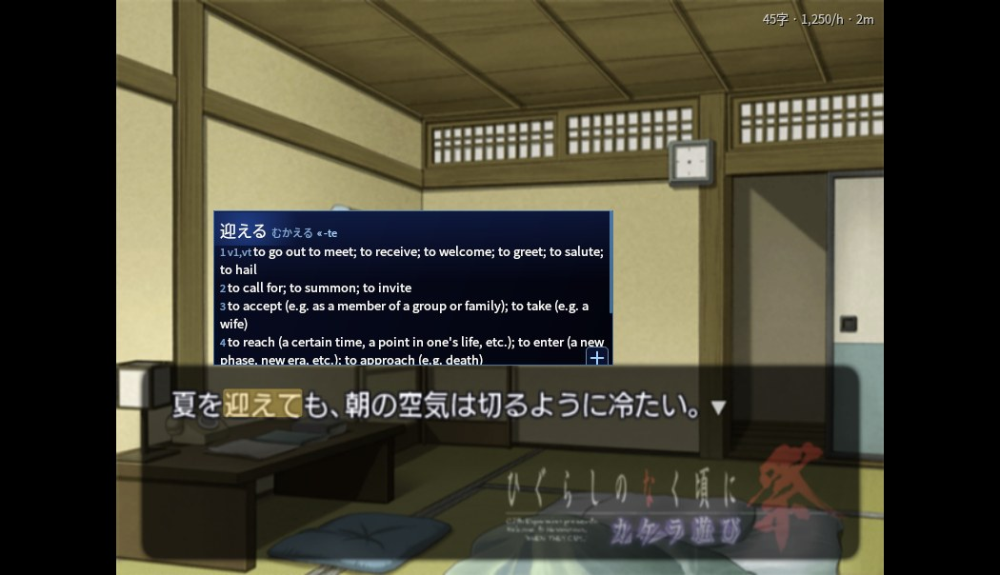
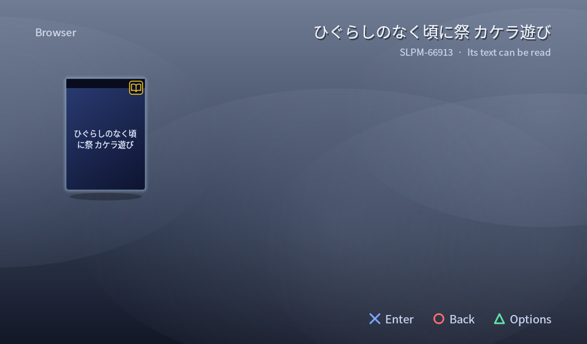

# PCSX2 Reader

Read Japanese PS2 games like a visual novel in a browser with Yomitan: point at a word in the
game's own text and its dictionary entry opens. Make Anki cards, keep a backlog and reading
statistics.

For Windows. The Android version is [ARMSX2 Reader](https://github.com/sommepo/armsx2-reader).

One of four [reader emulators](https://github.com/sommepo/readers) for PS2, PSP and Dreamcast games.

  

> A fork of [PCSX2](https://github.com/PCSX2/pcsx2) v2.8.2. It is not PCSX2: please report
> nothing about it to the PCSX2 project. PCSX2's README is [README.pcsx2.md](README.pcsx2.md).
> The reading layer is AI-written.

## Features

- **Look up words in the game's text.** Point at a word to see its entry. Clicking a word
  works too. Uses Yomitan dictionaries.
- **The word is outlined, and the outline glides** from word to word as you move along the
  line. Highlight or no mark at all instead, in Reader settings.
- **The popup stands right next to the word** and stays put while you go to its **+**, which
  sits in the bottom left of each entry (or any corner you choose).
- **Anki cards** with the sentence and a picture of the scene, through AnkiConnect.
- **Backlog and reading statistics.**
- **Go on to the next choice**: run a visual novel at full speed to its next choice.
- **The PS2's own menu** as the game list.
- **CRT picture** with a tube's frame around it (Reader settings).
- **Play by touch** for a touch screen: a click on the picture goes on, a click on an answer
  picks it (off at first, in Reader settings).
- **Routes finished elsewhere**: mark the CLANNAD routes you finished on another copy, so the
  game's own progress follows.
- **A Steam Controller's back buttons** are the reader's: pause the game to look words up,
  pause the statistics, make a card, open the backlog.

<table>
  <tr>
    <td width="33%"> A lookup</td>
    <td width="33%"> The PS2 menu</td>
    <td width="33%"> The Browser: a book marks a supported game</td>
  </tr>
</table>

## Get it

Download `PCSX2Reader-<version>-windows.zip` from the [releases](../../releases), unpack it and
start `pcsx2-reader.exe`. You need your own PS2 BIOS and games.

## Game scripts

A game is read through a **game script**: a small Lua file that tells the app where the game
keeps its text. The app installs them from the list in this repository: **Reader → Game
scripts…** (or *Game Scripts* in the PS2 menu). New games appear there without an app update.
You can also install a script from a file.

| Game | ID | Reads |
| --- | --- | --- |
| ひぐらしのなく頃に祭 カケラ遊び | SLPM-66913 | Story text, speakers, furigana |
| Ever17 -the out of infinity- Premium Edition | SLPM-65421 | Story text, speakers, choices |
| Remember11 -the age of infinity- | SLPM-65550 | Story text, speakers, choices |
| Never7 -the end of infinity- | SLPS-25256 | Story text, speakers, choices |
| アマガミ | SLPS-25918 | Message window, furigana, choices |
| CLANNAD | SLPM-66302 | Story text, speakers, choices; routes can be marked |
| ドラゴンクエストV 天空の花嫁 | SLPM-65555 | Message window, speakers |
| サイレントヒル2 | SLPM-65051 | Scene text and descriptions |
| EVE burst error PLUS | SLPM-65320 | Message window |
| うたわれるもの 散りゆく者への子守唄 | SLPS-25679 | Message window, speakers |
| シャドウハーツ | SLPS-25041 | Message windows, speakers |

### Writing a script

A script holds addresses and decoding logic only, never text or data from the game.
[READER.md](READER.md) explains how scripts work and how a game is run headless while one is
written; each game's notes are there too. Pull requests with new scripts are welcome.

## Building

See [READER.md](READER.md).

## Licence

GPL-3.0-or-later, as PCSX2 ([COPYING.GPLv3](COPYING.GPLv3)). The reading layer is in `reader/`.
