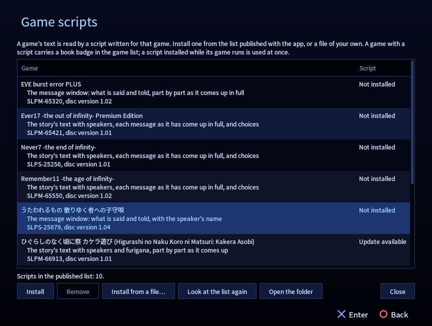

# PCSX2 Reader

Read Japanese PlayStation 2 games on a computer the way you read a visual novel in a browser
with Yomitan: click a word **in the game's own text** and its dictionary entry opens, one more
click makes an Anki card with the line and a picture of the game, and your reading is counted.
Nothing is drawn over the game.

For Windows (and Linux, built from source). Its Android sibling is
[ARMSX2 Reader](https://github.com/sommepo/armsx2-reader), which runs the same game scripts.

> PCSX2 Reader is a fork of the [PCSX2](https://github.com/PCSX2/pcsx2) emulator (v2.8.2) with
> a reading layer on top. **It is not PCSX2 and is not supported by the PCSX2 project**: please
> report nothing about it there. PCSX2's own README is [README.pcsx2.md](README.pcsx2.md).
> The reading layer's code is AI-written; nothing from here is to be sent upstream.

  
   
  ひぐらしのなく頃に祭 カケラ遊び: click a word in the game's own text box. Inflected words are traced back to their dictionary form.

## What it does

- **Look words up in the game's picture.** A word in a text box is real text: click it and a
  small popup shows its entries from the dictionaries you installed (dictionaries made for
  Yomitan).
- **Cards.** One click for a card of the word, with the line and a picture of the scene, in
  Anki through AnkiConnect.
- **Backlog and statistics.** Every line read, characters per hour, time per day and game.
- **Go on to the next choice.** For a visual novel you have partly read elsewhere: the game
  runs at full speed to its next choice.
- **The PS2's own look.** The console's system menu stands in for the game list, and every
  window of the reader wears its colours.
- It only does this for **games that have a game script** (below). Every other game runs as
  in PCSX2.

## What it looks like

<table>
  <tr>
    <td width="50%"> <b>A lookup.</b> 迎えて is looked up as 迎える; the popup stands over the game, which stays as it is.</td>
    <td width="50%"> <b>Game scripts.</b> The published list, with Install, Update and Remove.</td>
  </tr>
  <tr>
    <td> <b>The PS2's own menu</b> in place of the game list.</td>
    <td> <b>The Browser.</b> A book marks a game with a script.</td>
  </tr>
</table>

Pictures of the app on Linux (the same app as the Windows package), with the dictionary JMdict. A CRT picture setting is also there: the [ARMSX2 Reader README](https://github.com/sommepo/armsx2-reader#what-it-looks-like) shows it.

## Get it

From the [releases](../../releases) of this repository: `PCSX2Reader-<version>-windows.zip`.
Unpack it anywhere and start `pcsx2-reader.exe`. Windows needs Microsoft's "Visual C++
Redistributable" (the app says so if it is missing).

As with PCSX2, you bring your own games and the BIOS of your own console.

**How far it has been tried**: the games were read on Linux, and a word clicked in a game was
looked up on a Linux PC. The Windows package is built on Linux and **has not yet been started
on Windows**; no Anki card has been made with this app yet. [READER.md](READER.md), "State",
says what is there and what is not.

## Game scripts

The emulator knows where a game keeps its text only from a **game script** written for that
game: a small Lua file named after the disc's serial (`SLPM-65555.lua`) that reads the game's
memory once a frame and says what text is on the screen and where each character stands. The
app comes with none. It installs them from **the published list** in this repository
([`reader/profiles`](reader/profiles), listed in `reader/profiles/index.json`):

- **Reader → Game scripts…** (or *Game Scripts* in the PS2 menu's System Configuration) shows
  the games of the list and the scripts you have, and installs, updates and removes them. A
  script installed while its game runs is used at once.
- **Install from a file…** takes a script of your own (and a data file it asks for, such as
  `SLPM-65555.charset`). A script can also be put by hand into the app's `reader/profiles`
  folder (**Reader → Open the game scripts folder**).

A game with a script carries a book badge in the game list. The scripts are the same files
in ARMSX2 Reader, which installs them from this repository's list too.

**Games in the list** (each script's first lines say what it reads; [READER.md](READER.md),
"Games", has a paragraph on each): ひぐらしのなく頃に祭 カケラ遊び, Remember11, Ever17 Premium
Edition, Never7, ドラゴンクエストV 天空の花嫁, サイレントヒル2, アマガミ, and the games added
since (the list in the app is always the current one).

**Not published**: ペルソナ3, ペルソナ4, 真・女神転生III NOCTURNE マニアクス and DIGITAL
DEVIL SAGA have been read with scripts too, but those need a table of the game's own font made
from the game itself, which is game data; they are kept out of this repository for now.

### Writing a script

A script holds **addresses and decoding logic only**: no text, pictures or tables taken from
the game. [READER.md](READER.md) has the whole of it: how a profile reads memory and reports
text and where each character is drawn (`reader/core/lua_api.cpp` has the API), how a game is
run without a display and driven from a script while one is written
(`tools/reader/screen.sh`, `tools/reader/dc.py`), and each finished game's notes. Most of the
scripts here were written by an AI agent working from those notes; that is a fine way to make
one. Before sending one in: say which disc (serial and the program's CRC, which the script
checks) and what was seen read, and how far into the game.

Pull requests with new scripts are welcome. `tools/reader/scripts-index.py reader/profiles`
makes the list; a script that asks for a data file that is not in the folder is left out of
it.

## Building

[READER.md](READER.md) says how the app is built on Linux, run without a display for
development, and cross-built for Windows.

## Licence

GPL-3.0-or-later, as PCSX2 (see [COPYING.GPLv3](COPYING.GPLv3)). PCSX2 and its contributors
made the emulator; the reading layer is in `reader/`, and the upstream files it touches carry
a comment that begins `Reader fork`.
